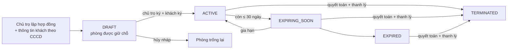
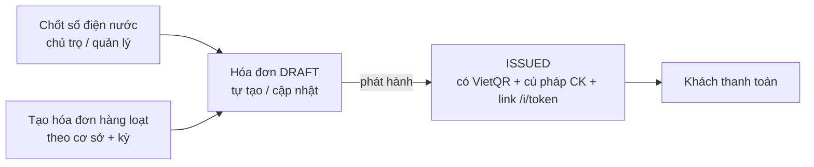
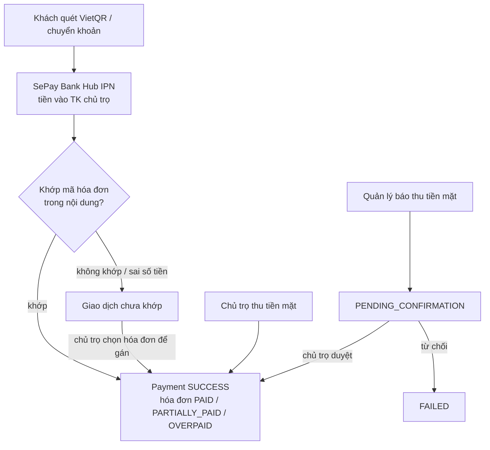
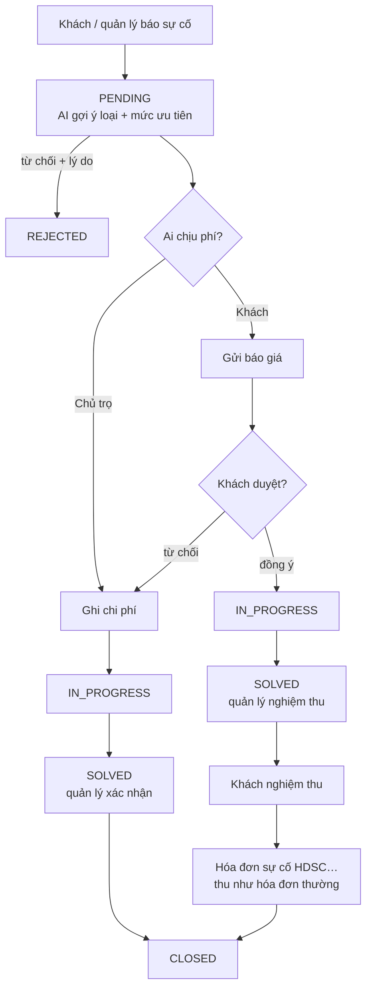
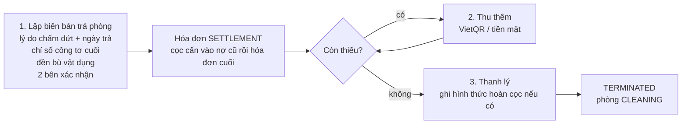

# DOMUS – Tổng quan nghiệp vụ và các luồng chính

> Cập nhật 13/11/2026, viết theo code hiện tại (BE Express + MongoDB, FE React). Chi tiết API xem `BE/API.md` và `docs/TASK_ASSIGNMENT_AND_API_CONTRACT.md`; quy tắc nghiệp vụ đầy đủ xem `docs/PROJECT_RULES.md`.

## 1. Hệ thống làm gì

DOMUS là phần mềm SaaS quản lý nhà trọ / căn hộ dịch vụ. Một **chủ trọ** thuê gói phần mềm của nền tảng, quản lý nhiều **cơ sở**, mỗi cơ sở có nhiều **phòng**. Hệ thống lo trọn vòng đời thuê phòng:

```
Cơ sở & phòng → Hợp đồng (nháp → ký 2 bên) → Thu cọc → Chốt điện nước hằng tháng → Hóa đơn
→ Khách trả tiền (VietQR / chuyển khoản / tiền mặt) → Đối soát tự động → Nhắc nợ
→ Sự cố & sửa chữa → Gia hạn hoặc thanh lý hợp đồng
```

Hai dòng tiền tách biệt hoàn toàn:

| Dòng tiền | Ai trả → ai nhận | Cổng |
| --- | --- | --- |
| Tiền phòng, cọc, phí sửa chữa | Khách thuê → **tài khoản ngân hàng riêng của chủ trọ** | VietQR + SePay Bank Hub (đối soát), tiền mặt |
| Phí gói phần mềm | Chủ trọ → **nền tảng** | payOS |

## 2. Vai trò

| Vai trò | Tạo bởi | Làm được gì |
| --- | --- | --- |
| **SUPER_ADMIN** (nền tảng) | Tạo tay trong DB | Quản lý gói SaaS, chủ trọ (khóa / mở), thuê bao, hóa đơn gói, duyệt yêu cầu đổi gói, xem analytics, audit log, giám sát tài khoản nhận tiền của chủ trọ (chỉ xem). |
| **LANDLORD** (chủ trọ) | Tự đăng ký | Toàn quyền dữ liệu của mình: cơ sở, phòng, hợp đồng, hóa đơn, duyệt tiền mặt, đối soát, phiếu chi, quản lý, gói phần mềm, liên kết ngân hàng, dashboard doanh thu. |
| **PROPERTY_MANAGER** (quản lý cơ sở) | Chủ trọ tạo, cấp mật khẩu tạm | Chỉ trong các cơ sở được giao: phòng, chốt điện nước, xem hóa đơn, thu tiền mặt (chờ chủ trọ duyệt), xử lý sự cố, báo giá, phiếu chi, gửi email nhắc nợ. Không xem doanh thu tổng. Chủ trọ **bật / tắt từng quyền** và **khóa / mở khóa** tài khoản (mục 4.2). |
| **TENANT** (khách thuê) | Tự sinh khi lập hợp đồng (theo CCCD) | Ký hợp đồng, xem / trả hóa đơn, báo sự cố, duyệt báo giá và nghiệm thu sửa chữa, xem biên nhận cọc. Tài khoản tự khóa khi hết hợp đồng và hết nợ. |

Một CCCD / SĐT có thể là khách của nhiều chủ trọ → khi đăng nhập trùng, hệ thống cho chọn tài khoản.

## 3. Danh mục đối tượng và trạng thái

| Đối tượng | Trạng thái |
| --- | --- |
| Tài khoản quản lý | `ACTIVE` · `SUSPENDED` (chủ trọ khóa, bị đăng xuất ngay) |
| Phòng | `EMPTY` trống · `RENTED` đang thuê · `MAINTENANCE` bảo trì · `CLEANING` dọn dẹp · `INACTIVE` ngừng |
| Hợp đồng | `DRAFT` nháp · `ACTIVE` hiệu lực · `EXPIRING_SOON` còn ≤ 30 ngày · `EXPIRED` quá hạn · `TERMINATED` đã thanh lý. Quyết toán: `settlement.state` `PREPARED` (đã lập biên bản) → `COMPLETED` |
| Lý do chấm dứt | `EXPIRED` hết hạn · `MUTUAL` thỏa thuận · `TENANT_EARLY` khách trả trước hạn có báo trước · `TENANT_BREACH` khách vi phạm · `LANDLORD_EARLY` chủ trọ chấm dứt trước hạn |
| Loại phòng (vật dụng) | `FURNISHED` đầy đủ đồ · `UNFURNISHED` phòng trống |
| Tiền cọc | `UNPAID` · `PAID` · `APPLIED` (cấn trừ khi thanh lý) · `REFUNDED` / `PARTIALLY_REFUNDED` |
| Hóa đơn (`MONTHLY` / `SETTLEMENT` / `INCIDENT`) | `DRAFT` nháp · `ISSUED` chờ trả · `PARTIALLY_PAID` trả một phần · `PAID` · `OVERPAID` trả thừa · `CANCELLED`. "Quá hạn" là suy ra từ hạn nộp, không lưu. |
| Thanh toán (`INVOICE` / `CONTRACT_DEPOSIT`) | `PENDING_CONFIRMATION` chờ duyệt (tiền mặt do quản lý thu) · `SUCCESS` · `FAILED` · `REFUNDED`; phương thức `VIETQR` / `BANK_TRANSFER` / `CASH` / `DEPOSIT` |
| Giao dịch chưa khớp | `PENDING_REVIEW` · `RESOLVED` · `IGNORED` |
| Phiếu chi | `RECORDED` · `VOID` |
| Sự cố | `PENDING` → `IN_PROGRESS` → `SOLVED` → `CLOSED`; hoặc `REJECTED`. Người chịu phí: `LANDLORD` / `TENANT` / `NONE` |
| Báo giá sự cố | `PENDING` · `ACCEPTED` · `DECLINED` · `CANCELLED` |
| Thuê bao gói | `PENDING_PAYMENT` · `ACTIVE` · `EXPIRED` · `CANCELLED` |
| Hóa đơn gói | `PENDING` · `PAID` · `OVERDUE` · `CANCELLED` |

## 4. Các luồng chính

### 4.1 Chủ trọ bắt đầu dùng hệ thống

1. Chủ trọ đăng ký → tự đăng nhập → chọn gói. Gói trả phí sinh **hóa đơn gói** và thuê bao `PENDING_PAYMENT`.
2. Thanh toán gói qua **payOS**: BE tạo link (`POST /plans/invoices/:id/checkout`) → chủ trọ trả trên trang payOS → payOS gọi webhook `POST /plans/payments/ipn` (xác thực chữ ký) → gói `ACTIVE`. Nếu webhook chưa về, FE gọi `verify-payment` để hỏi lại payOS.
3. Đổi gói: gửi **yêu cầu đổi gói** → admin duyệt.
4. Mỗi gói có đủ tính năng, chỉ khác **hạn ngạch** (số cơ sở, phòng, quản lý). Vượt hạn ngạch → `QUOTA_EXCEEDED`.
5. **Liên kết ngân hàng** qua SePay Bank Hub (iframe): từ đây tiền khách chuyển vào tài khoản chủ trọ được tự đối soát.

### 4.2 Cơ sở, phòng, quản lý

- Tạo cơ sở (địa chỉ, bảng giá điện / nước / dịch vụ mặc định, **danh mục vật dụng bàn giao kèm đơn giá đền bù**) → tạo phòng (lẻ hoặc hàng loạt), phòng có thể ghi đè giá.
- **Vật dụng bàn giao** (tránh tranh chấp hư hỏng): mỗi món có tên, số lượng, đơn giá đền bù, tình trạng. Mỗi phòng chọn **phòng trống** (không kèm đồ) hoặc **đầy đủ đồ** (dùng danh mục của cơ sở hoặc danh mục riêng của phòng).
- Tạo tài khoản quản lý, gán cơ sở. Quản lý đăng nhập bằng SĐT + mật khẩu tạm, bị buộc đổi mật khẩu lần đầu.
- **Phân quyền quản lý**: chủ trọ bật / tắt 7 quyền cho từng người (sửa phòng, chốt điện nước, xử lý sự cố, lập phiếu chi, xem hóa đơn & thanh toán, báo thu tiền mặt, gửi email nhắc nợ). Mặc định bật hết; quyền bị tắt trả lỗi `PERMISSION_DISABLED` từ thao tác kế tiếp.
- **Khóa tài khoản quản lý**: đăng xuất ngay, không đăng nhập và không cấp lại mật khẩu được cho đến khi mở khóa; mở khóa giữ nguyên mật khẩu, quyền, cơ sở. Tài khoản bị khóa vẫn tính vào hạn ngạch quản lý của gói.

### 4.3 Hợp đồng và tiền cọc



- Lập hợp đồng → tự tạo / mở lại tài khoản khách theo CCCD → hợp đồng **nháp**, phòng chuyển `RENTED` (giữ chỗ).
- **Một CCCD, một hợp đồng còn hiệu lực** với mỗi chủ trọ: CCCD của khách và người ở cùng không được trùng nhau trong một hợp đồng, và không được đang có tên trong hợp đồng nháp / đang chạy khác. Form báo lỗi ngay khi nhập; server kiểm tra lại khi lưu.
- Hợp đồng **chép lại danh mục vật dụng** và đơn giá đang áp dụng cho phòng lúc lập; sửa danh mục sau đó không làm đổi hợp đồng. Chi tiết hợp đồng có bảng tài sản bàn giao và điều khoản bồi thường theo đơn giá này.
- **Cả hai bên ký** mới có hiệu lực (chữ ký thứ hai kích hoạt). Hợp đồng nháp **không** chốt điện nước, **không** tạo hóa đơn (`CONTRACT_NOT_SIGNED`).
- **Tiền cọc** nhận được ngay từ lúc nháp:
  - Khách chuyển khoản theo VietQR cọc → Bank Hub đối soát → ghi nhận tự động; hoặc
  - Chủ trọ bấm "Đã nhận cọc" (tiền mặt / chuyển khoản).
  - Mỗi lần nhận cọc tạo **biên nhận cọc** (`Payment` loại `CONTRACT_DEPOSIT`), khách xem và in được. Tiền cọc **không** tính vào doanh thu.

### 4.4 Chốt điện nước → hóa đơn tháng



- Mỗi phòng mỗi kỳ có một bản chốt. Chỉ số bất thường (giảm, tăng vọt) phải xác nhận lại.
- Hóa đơn = tiền phòng + điện + nước (theo đồng hồ / đầu người / khoán) + dịch vụ + phí phát sinh − giảm trừ.
- Phát hành → khóa số liệu, sinh **VietQR động** (đúng số tiền và nội dung `HDxxxx Pxxx`) và **link No-App** `/i/<token>` để khách xem, trả tiền mà không cần đăng nhập.
- Một phòng chỉ có một hóa đơn sống cho mỗi kỳ. Hủy hóa đơn phải ghi lý do.

### 4.5 Thanh toán và đối soát



- **Tự động**: nội dung chuyển khoản chứa mã hóa đơn → ghi nhận ngay, cập nhật số đã trả / còn lại, gửi realtime.
- **Chưa khớp** (sai cú pháp, không thấy hóa đơn, hóa đơn đã trả, gói không có đối soát tự động…) → trang **Đối soát giao dịch**: chủ trọ chọn hóa đơn trong danh sách (có gợi ý theo số phòng / tên khách / số tiền) để gán.
- **Tiền mặt**: chủ trọ thu là xong; quản lý thu thì phải chờ chủ trọ duyệt. Lịch sử ghi rõ người nộp, người thu, người duyệt.
- **Lịch sử thanh toán** chia tab: tiền phòng · sửa chữa · tiền cọc · phiếu chi · chưa khớp; in được biên nhận.
- Môi trường thử nghiệm có nút **giả lập thanh toán** (tạo giao dịch ngân hàng giả đi qua đúng luồng đối soát). Không bao giờ bật ở production.

### 4.6 Nhắc nợ qua email

- Dashboard liệt kê hóa đơn còn nợ (quá hạn lâu nhất trước) kèm nút **Gửi email**.
- Job tự động mỗi giờ (chỉ 8:00–20:00): 3 ngày trước hạn, đúng hạn, 1 ngày sau hạn, rồi 3 ngày / lần tới 60 ngày; tối đa 1 email / hóa đơn / ngày. Chủ trọ bật / tắt được.
- Email **gửi thay mặt chủ trọ**: tên người gửi là cơ sở / chủ trọ, trả lời thư về thẳng email chủ trọ; nội dung có số tiền, hạn, nút mở link VietQR và thông tin chuyển khoản.
- Gửi qua Gmail SMTP (local) hoặc Brevo (deploy). Khách phải có email trong hồ sơ.

### 4.7 Sự cố và sửa chữa



- **Chủ trọ chịu phí**: chỉ cần quản lý xác nhận đã sửa xong.
- **Khách chịu phí**: báo giá → khách đồng ý → sửa → nghiệm thu **hai bên** → tự sinh **hóa đơn sự cố** (thanh toán VietQR / tiền mặt như hóa đơn tháng). Ảnh nghiệm thu không bắt buộc.
- **Khóa người chịu phí**: đã chọn chủ trọ chịu thì không gửi báo giá cho khách và ngược lại; ngoại lệ duy nhất là khách từ chối báo giá thì chủ trọ có thể nhận chịu.
- Tiền trả cho thợ / bên ngoài ghi bằng **phiếu chi** gắn với sự cố; chi tiết sự cố hiện đã thu, đã chi, chênh lệch.

### 4.8 Gia hạn, quyết toán và thanh lý

- **Gia hạn**: chủ trọ tạo phụ lục, đổi ngày kết thúc (và giá nếu có).
- **Quyết toán & thanh lý** gồm 3 bước:



  - **Lý do chấm dứt** phải khớp ngày trả phòng: "hết hạn" chỉ từ ngày kết thúc trở đi; ba lý do "trước hạn" phải trước ngày kết thúc.
  - **Biên bản tính**: nợ hóa đơn cũ + tiền phòng / nước khoán / dịch vụ của những ngày lẻ chưa có hóa đơn + điện nước theo công tơ cuối + đền bù. Ảnh công tơ và ảnh hư hỏng không bắt buộc.
  - **Đền bù vật dụng**: chọn món trong danh mục đã bàn giao của hợp đồng; tiền đền bù tối đa bằng đơn giá × số lượng đã thỏa thuận; hao mòn tự nhiên không tính.
  - **Giữ cọc**: chỉ khi khách vi phạm (`TENANT_BREACH`), chủ trọ được chọn giữ lại phần cọc còn dư sau khi trừ nợ; không bao giờ làm khách nợ thêm.
  - **Hoàn cọc**: nếu còn tiền trả lại khách, phải ghi hình thức đã hoàn (tiền mặt / chuyển khoản) mới thanh lý được. Biên bản thanh lý lưu lý do, từng khoản, tiền cọc hoàn / giữ lại.
- Job khóa tài khoản: khách không còn hợp đồng (quá 30 ngày sau khi kết thúc) và không còn nợ → tài khoản tự khóa; lập hợp đồng mới cùng CCCD thì mở lại với mật khẩu cũ.

### 4.9 Dashboard, thông báo, realtime

- **Dashboard chủ trọ**: dự thu vs thực thu theo kỳ, dòng tiền thực nhận trong tháng (không tính cọc), phiếu chi, dòng tiền ròng, công nợ, tỷ lệ lấp đầy, hợp đồng sắp hết hạn.
- **Realtime (Socket.io)**: mọi thay đổi phát `data:changed` để trang tự tải lại; "Hoạt động gần đây" chỉ gửi đúng nhóm liên quan (chủ trọ / quản lý cơ sở / khách của hợp đồng / admin).
- Chuông thông báo "Việc cần xử lý" theo vai trò; tìm kiếm toàn cục.

### 4.10 Admin nền tảng

- Gói SaaS (giá, hạn ngạch), danh sách chủ trọ (khóa / mở, trạng thái liên kết ngân hàng, giao dịch chờ đối soát), thuê bao, hóa đơn gói (xác nhận tay khi cần), yêu cầu đổi gói, analytics, audit log (giữ 1 năm; dữ liệu tài chính 10 năm).

## 5. Quy tắc xuyên suốt

- **Phân quyền theo phạm vi**: chủ trọ thấy dữ liệu của mình; quản lý chỉ thấy cơ sở được giao; khách chỉ thấy hợp đồng / hóa đơn của mình.
- **Tiền tệ** là số nguyên VND; mọi thao tác tài chính chạy trong transaction MongoDB và ghi audit log.
- **Thông báo lỗi** là câu nghiệp vụ tiếng Việt, không hiện mã lỗi hay tên trường kỹ thuật.
- **Thời gian nghiệp vụ** (kỳ, hạn nộp, ngày giao dịch) tính theo giờ Việt Nam.

## 6. Tích hợp bên ngoài

| Dịch vụ | Dùng cho | Cấu hình chính |
| --- | --- | --- |
| SePay Bank Hub | Liên kết TK ngân hàng chủ trọ, nhận IPN tiền vào để đối soát | `SEPAY_BANKHUB_*` |
| VietQR | Ảnh QR động trên hóa đơn / cọc | Thông tin ngân hàng chủ trọ |
| payOS | Thu phí gói SaaS | `PAYOS_CLIENT_ID`, `PAYOS_API_KEY`, `PAYOS_CHECKSUM_KEY` |
| Gmail SMTP / Brevo | Email nhắc nợ | `SMTP_*` / `BREVO_API_KEY`, `EMAIL_FROM_ADDRESS`, `PUBLIC_APP_URL` |
| TypeSafe Jev | Gợi ý loại và mức ưu tiên sự cố | `TYPESAFE_API_KEY` |
| Render / Vercel | Deploy BE / FE | `CLIENT_URL`, `PUBLIC_APP_URL`, `COOKIE_SAME_SITE=none`, `TRUST_PROXY=1` |
